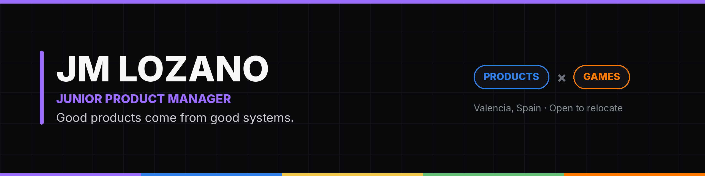
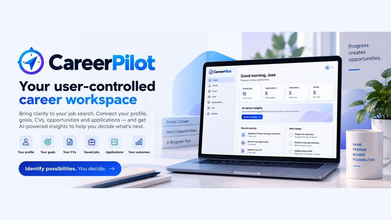
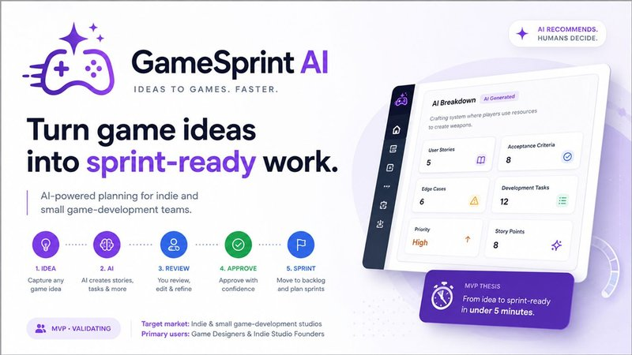
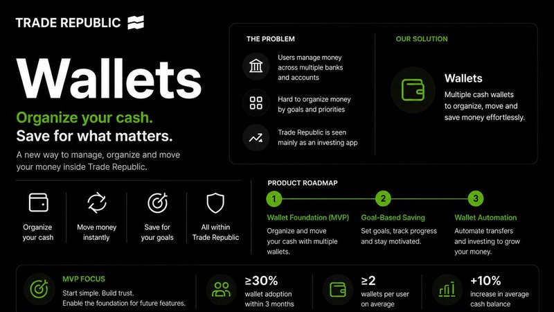
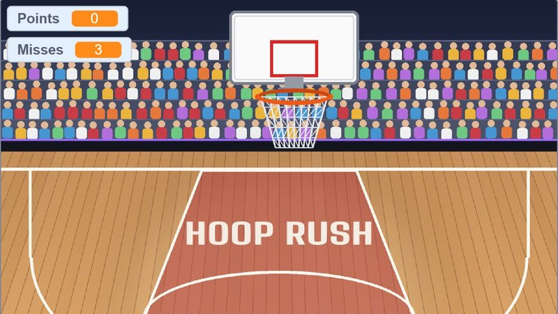

## Hi, I'm Jose Manuel 👋

**Junior Product Manager** working at the intersection of **products and games**.
Based in Valencia, Spain, and open to relocating.

- 🚀 **Right now:** building and launching two AI products in the PM Accelerator AI Product Management Bootcamp.
- 🌱 **Learning:** Harvard's CS50x, SQL and Python. I'm learning to code so I can talk to developers in their language, not just about their tickets.
- 🎯 **Looking for:** a junior product role on a team that ships, where I can own a backlog. Long term: game production.

### About me

Games have been part of my life since Pokémon Sapphire on a Game Boy Advance. I wanted to make them, found out I wasn't good at any part of building them, and found my way in through the people who make sure games actually get made: producers and product managers.

Before product, I spent nine seasons refereeing basketball with the Valencian federation: more than 1,000 games of explaining decisions clearly and staying calm when nobody else is.

---

### 🧩 Featured work

<table>
  <tr>
    <td width="50%" valign="top">
      
      <h4>CareerPilot</h4>
      
AI decision support for job seekers. Research killed the CV-builder idea, so I pivoted to helping people decide where to put their effort next.

      
Course project · Solo · Lovable

      <a href="https://github.com/jm-lozano-pm/CareerPilot">Repo &amp; PRD</a> · <a href="https://my-career-flightplan.lovable.app">Live MVP ↗</a>
    </td>
    <td width="50%" valign="top">
      
      <h4>GameSprint AI</h4>
      
From game idea to sprint-ready work: an AI-assisted B2B tool for small game-dev teams, tested with real developers.

      
Course project · Team of 2 · Lovable, Jira

      <a href="https://github.com/jm-lozano-pm/GameSprint-AI">Repo &amp; PRD</a> · <a href="https://sprintwiz-game.lovable.app/">Live MVP ↗</a>
    </td>
  </tr>
  <tr>
    <td width="50%" valign="top">
      
      <h4>Trade Republic Wallets</h4>
      
Purpose-based wallets inside one app. I owned about 90% of the Figma prototype.

      
Case study · Team of 3 · Figma

      <a href="https://github.com/jm-lozano-pm/Trade-Republic-Wallets">Repo &amp; PRD</a>
    </td>
    <td width="50%" valign="top">
      
      <h4>🎮 Hoop Rush</h4>
      
A basketball arcade game: hit 21 baskets before you miss three, while the hoop speeds up with every point. Scoped, documented and shipped in one day.

      
CS50x · Solo · Scratch

      <a href="https://github.com/jm-lozano-pm/Hoop-Rush">GDD &amp; PRD</a> · <a href="https://scratch.mit.edu/projects/1397164859">Play on Scratch ↗</a>
    </td>
  </tr>
</table>

---

### 🛠️ Toolkit

**Tools**

**Code** · learning

**Languages** · Spanish (native) · Catalan (native) · English (working language)

### 🎓 Certifications

- [Professional Scrum Product Owner I (PSPO I)](https://www.credly.com/badges/3cde2291-1c44-421c-8bc3-0479c7c46fd5) · Scrum.org · 79/80
- [Claude 101](https://academy.claude.com/verify/1dab25c1fa6450e21559140f012a1423) · Anthropic Claude Academy
- [Google Project Management Certificate](https://www.credly.com/badges/f66c3f07-0b18-49b5-92ff-efdb6a3fc620/public_url) · Google · Coursera

---

### 📫 Find me at

